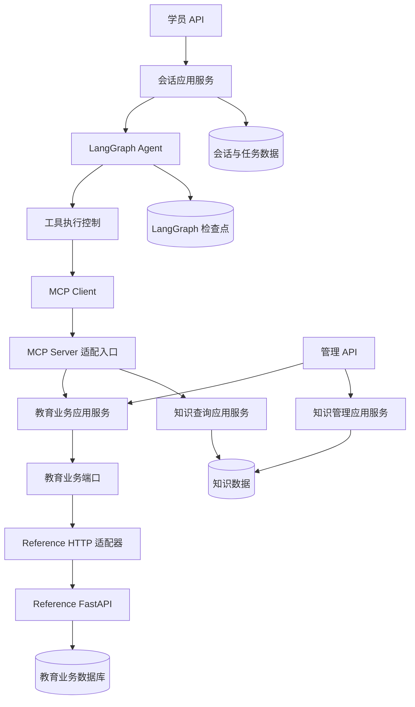

# 教育智能客服系统：后端解耦与设计方案

版本：v0.3，设计与实现对照，2026-11-18。产品范围已确认，当前验证结果见《开发进度.md》，运行步骤见《启动与验证.md》。本文保留设计推导，下面的实现对照优先于未落地的建议。

## 实现对照

- 新应用采用模块化单体，模块按 `main.py`（HTTP/组装）、`agent.py`、`mcp_tools.py`、`education.py`、`knowledge.py`、`storage.py`、`config.py` 划分；暂不机械创建多层目录。
- 新应用消息、任务、知识与审计采用 SQLite WAL，LangGraph 使用独立 SQLite 检查点；教育业务仍使用 MySQL。当前限制为单实例，通过租约防止多实例同时恢复任务。
- MCP Streamable HTTP 与新应用同进程挂载，教育后端独立运行并验证服务凭据；模型看不到可信身份能力令牌。
- 管理员账号使用本地配置或随机生成密码；学员使用明确标识的预置身份演示入口。
- 学员客服界面与管理后台已经实现；本文仍不展开前端设计。

## 最新产品决策（优先于下文初稿）

- 交付完整演示项目，包含真实模型调用、持久化、学员客服界面和管理后台。
- 学员侧只建设客服界面，不建设教育平台的购买、支付或学习门户；通过客服完成查询、申请及处理结果查看。
- 前端视觉克制、实用，有适度设计感，避免常见 AI 模板风格与过于前卫的表现。
- 用户明确提出办理诉求后，Agent 在信息齐全、业务校验通过时直接提交退款申请或工单；信息缺失时主动追问，不增加统一的二次确认步骤。仅讨论政策或假设场景不视为提交授权；诉求或关联对象不明确时先澄清。
- 工单支持学员补充说明、管理员回复、处理记录和结单，不提供实时人工聊天。
- 学员侧使用数据库中的预置学员供切换体验，不建设完整学员登录系统。切换身份后必须隔离会话及业务数据，不能把上一位学员的上下文带给下一位。
- 知识管理第一版仅支持后台编辑 FAQ 和文章，不提供文档上传；保留未来增加内容来源的扩展能力。
- 知识无依据或当前能力无法解决问题时，明确说明无法解决，询问是否创建工单；只有用户同意后才收集缺失信息并提交。
- 第一版仅支持全额退款，由系统计算当前可退金额，管理员通过或驳回，不提供人工输入部分退款金额。
- 管理员填写处理结果后直接关闭工单；学员可查看全部公开回复和结果，内部备注不向学员开放。
- 学员、课程、班次、订单、学习记录以查询为主；管理写操作集中于 FAQ/文章维护、工单处理和退款审批。

## 1. 目标与范围

复用 `reference` 中的教育业务后端，开发以 LangGraph Agent 为核心的智能客服，并提供知识管理、工单处理、退款审批等管理能力。本文不包含前端设计。

已确定的范围：

- 学员通过 Agent 咨询课程、查询订单和学习进度、提交退款申请和问题工单。
- 管理员维护 FAQ、政策文章，处理工单、审批退款，查询必要的教育业务信息。
- 不单独建设客服人员端，不提供实时人工会话接管。
- 第一版不接真实支付，退款审批通过后模拟退款执行。
- 知识检索先采用基础方式，保留替换检索实现和增加内容来源的能力。
- 不根据参考 README 重建完整教育平台，不实现课酬、返佣、完整营销等外围业务。

## 2. 对现有代码的判断

`reference` 包含 FastAPI 应用、MySQL 建表脚本、种子数据、数据生成脚本和接口测试。已有课程、班次、订单、学习进度、退款申请、工单提交等能力，主要面向学员业务，并非完整管理后台。

已完成数据库及核心接口运行验证，并修正学习进度统计口径。原业务数据保留，新增所需管理与幂等能力；详细验证记录见《开发进度.md》。

采用“保留业务后端，通过适配器接入”的策略，避免先全面重构。发现影响目标场景的缺陷时局部修复；新增退款审批、工单处理等能力时明确服务边界。

## 3. 总体架构

新开发部分按模块化单体组织，通过端口与适配器隔离具体实现。参考业务后端初期独立运行，通过 HTTP 接入，因此整个运行环境初期包含两个后端进程；这不是把所有模块拆成微服务。



MCP Server 是能力的协议入口，业务规则放在应用服务或教育后端中。管理 API 与 MCP 工具复用应用能力，避免各写一套业务逻辑。

第一版建议新应用使用一个部署单元，提供 HTTP API 和 MCP Streamable HTTP 入口；MCP Client 的连接、超时和关闭由应用生命周期统一管理。具体挂载与鉴权方式在实现前用选定版本的 SDK 做小闭环验证。本地独立调试 MCP 时可使用 stdio。

## 4. 模块职责与依赖

| 模块 | 自己负责 | 通过什么访问其他能力 |
| --- | --- | --- |
| 身份与权限 | 登录身份、角色、账号状态、服务间可信身份映射 | 身份上下文接口 |
| 会话管理 | 消息、会话归属、请求去重、事件记录、任务与办理诉求记录 | Agent 执行接口、持久化端口 |
| Agent | 理解目标、选择工具、补齐信息、组织回复、执行中断与恢复 | 工具目录、工具执行控制 |
| 教育业务接入 | 面向客服和管理员的业务用例、参数和结果转换 | 教育业务端口及 Reference HTTP 适配器 |
| 知识管理与查询 | FAQ、文章、发布状态、基础检索、来源信息 | 内容仓储与检索端口 |
| MCP 适配 | 工具声明、协议参数和结果转换、可信调用身份接入 | 教育与知识应用服务 |
| 公共基础设施 | 配置、数据库会话、HTTP 客户端、日志和追踪 | 为各模块实现基础设施接口 |

约束：Agent 不写 SQL，不直接调用 Reference 路由函数；知识模块不导入 LangGraph；业务核心不依赖 MCP SDK；HTTP/MCP 入口不承载核心业务规则。跨模块访问公开应用接口，避免直接读取对方的数据表。

建议目录：

```text
edu_support/
├── doc/
├── reference/                 # 原有教育业务基线
├── src/edu_support/
│   ├── bootstrap/             # 组装依赖、启动入口
│   ├── identity/              # 身份与授权
│   ├── conversation/          # 会话、消息、待办、办理诉求
│   ├── agent/                 # 图、状态、提示词、工具控制
│   ├── education/             # 应用服务、端口、HTTP 适配器
│   ├── knowledge/             # 内容管理、检索端口和实现
│   ├── entrypoints/
│   │   ├── http/              # 学员与管理接口
│   │   └── mcp/               # 工具协议适配
│   └── infrastructure/        # 配置、连接、日志
└── tests/
```

具体小模块只创建实际需要的文件，不为每个对象机械复制多层目录。

## 5. Reference 接入与补充

| 能力 | 已有基础 | 接入策略 |
| --- | --- | --- |
| 课程咨询 | 课程系列、班次列表与详情 | 组合为面向客服的查询结果 |
| 订单查询 | 当前用户订单列表、订单详情 | 支持按订单号定位，再解析内部 ID |
| 学习进度 | 已报名班次、班次进度 | 核对视频和作业等统计口径后接入 |
| 退款申请 | 创建及查询退款申请 | 增加全额退款计算、幂等与资格查询能力 |
| 退款审批 | 当前未发现完整管理接口 | 在教育后端补充审批和模拟退款事务 |
| 工单提交 | 创建及查询学员工单 | 评估放宽订单必填约束，支持无订单问题 |
| 工单处理 | 当前未发现完整管理接口 | 补充管理员查询、回复、状态变更与处理记录 |
| 知识维护 | 未发现 FAQ/文章模块 | 在新应用内实现 |

退款审批对申请、订单、支付和报名关系的更新，应在教育后端的同一业务事务内完成。新应用不能通过多次 HTTP 调用分别修改这些表来假装原子操作。

新增管理接口必须校验管理员权限。Reference 的 `X-User-Id` 只是演示身份机制；接入时由服务端将已认证身份映射为业务用户，不接受模型指定任意用户 ID。Reference 应限制为内部可访问，并验证可信服务凭据，防止绕过新应用伪造请求头。

## 6. Agent：通用执行循环与确定性约束

不以“业务、查询、闲聊”三分类后进入大量固定图为主架构。建议采用通用循环：

```text
接收并保存消息 → 载入身份与任务状态 → 模型推理
    → 生成回复
    → 或提出工具调用 → 权限/参数/办理诉求检查 → 执行工具
                                           → 保存结果 → 继续推理
    → 或等待用户补充/澄清，持久化并中断
```

模型负责工具选择和组合；LangGraph 负责循环、状态、检查点与恢复；业务端保证操作合法。设置最大步骤、执行时限和工具结果大小，超过限制保存状态并明确反馈。

增加新知识通常不改图；增加可复用业务能力需要实现应用接口和工具描述，并经过评估后加入工具目录。MCP 的发现能力不代表自动信任或自动启用任意新工具。

身份、工具白名单、读写属性、办理诉求要求由程序配置。工具描述、知识正文和模型输出不能修改权限策略。

## 7. 工具设计

先提供业务级工具，避免暴露任意 SQL、通用字段修改和全部 CRUD。

| 类型 | 建议工具 | 执行限制 |
| --- | --- | --- |
| 课程 | `search_courses`、`get_course_detail` | 公开在售内容 |
| 订单 | `list_my_orders`、`get_my_order` | 当前学员的数据 |
| 学习 | `list_my_cohorts`、`get_my_learning_progress` | 当前学员的报名关系 |
| 知识 | `search_knowledge`、`get_knowledge_item` | 已发布、当前身份可见的内容 |
| 退款 | `check_refund_eligibility`、`submit_refund_application` | 明确退款诉求、信息齐全，系统计算金额并校验 |
| 工单 | `submit_ticket`、`list_my_tickets`、`get_my_ticket`、`append_my_ticket_message` | 明确提交或补充诉求，校验归属；兜底建单先征得同意 |

管理员退款审批、知识发布等工具不进入学员 Agent 的工具目录。

工具结果采用明确的业务契约，例如：

```json
{
  "ok": true,
  "data": {"application_id": "RF...", "status": "pending"},
  "error": null,
  "meta": {"source": "education", "trace_id": "..."}
}
```

失败时使用稳定错误码，区分参数错误、无权访问、状态冲突、超时和服务不可用。是否重试由错误类型和操作幂等性判断，不盲目重试写操作。

## 8. 状态、办理诉求与一致性

分别持久化原始消息、模型与工具消息、任务状态、用户办理诉求及业务操作记录。LangGraph 检查点用于恢复图执行，不替代业务数据库。

建议任务状态包含：任务 ID、目标、状态、关联业务对象、已收集信息及来源消息、办理诉求来源、待澄清事项和已完成操作 ID。输入允许一次提供多个字段，也允许后续更正；字段提取后仍需校验业务归属和有效性。

切换需求时保存原任务为暂停，新建或激活目标任务；恢复时重新校验可能过期的订单、政策和退款条件。取消任务终止后续执行并保留审计记录，不删除已创建的业务申请；撤销业务申请需单独操作。

提交过程：识别明确办理诉求并关联原始消息 → 收集缺失信息 → 服务端校验 → 幂等提交。用户修改订单时重新校验归属和退款条件，系统重新计算金额。仅咨询政策不得触发退款申请；兜底建单必须有用户同意的消息依据。模型意图判断仍可能出错，使用反例评估和可追溯记录控制风险，不宣称仅凭自然语言识别即可绝对保证授权。

同一会话的变更按顺序处理，防止两个消息同时覆盖状态。跨进程时使用数据库版本控制或租约等协调机制，不只依赖进程内锁。

消息使用 `request_id` 去重；写操作使用稳定的 `operation_id`。幂等键必须传到实际执行事务的教育后端，并在那里持久化结果。出现“提交成功但响应丢失”时，查询原结果或以相同键重试，避免重复创建。仅在 MCP 层去重不能解决这个问题。

## 9. 知识模块的扩展方式

第一版支持 FAQ（标准问题、相似问法、答案）和文章（标题、正文、分类、标签），提供草稿、发布、下架状态和修改记录。基础检索只返回已发布且可访问内容。

客服依赖统一 `KnowledgeSearchPort`，输入查询词、可选过滤条件、结果数量和可信访问上下文；输出统一命中项：内容 ID、版本、类型、标题、片段、来源引用。评分允许为空或仅供当前检索器内部排序，不把不同检索器的原始分数假定为同一可信度。

先实现数据库关键词检索；后续通过适配器增加全文检索、向量检索、外部知识源或组合检索。文章版本变化、下架时，检索实现负责同步生效；未来使用异步索引时要显式管理索引状态与版本。

退款政策文本用于解释，退款资格和金额由业务代码计算。客服不执行知识内容中夹带的工具调用指令。

## 10. 接口与数据归属

| API 组 | 职责 |
| --- | --- |
| `/api/v1/auth/*` | 登录与身份管理 |
| `/api/v1/conversations/*` | 创建会话、提交消息、读取历史与状态、取消任务、SSE 事件 |
| `/api/v1/me/*` | 学员自己的工单与退款结果等查询 |
| `/api/v1/admin/education/*` | 管理侧业务查询 |
| `/api/v1/admin/tickets/*` | 工单处理 |
| `/api/v1/admin/refunds/*` | 退款审批与结果查询 |
| `/api/v1/admin/knowledge/*` | FAQ、文章维护与检索预览 |
| `/mcp` | 通过鉴权的业务与知识工具入口 |

这是接口分组草案，不是最终 OpenAPI 定义。

教育后端拥有课程、订单、退款、报名和工单数据；新应用拥有身份映射、会话、任务、办理诉求、工具执行记录以及知识内容。初期可共用 MySQL 实例，但建议使用独立数据库/schema，避免跨模块直接写表。

流式和非流式共用同一执行服务。流式事件区分文本增量、待补充信息、操作结果、完成和错误；业务编号、金额、状态保留结构化结果。SSE 断开不等于业务取消；断开后可查询执行状态并重取已保存事件，不能因重连重复执行写操作。

模型解释允许自然语言生成，关键事实直接使用工具结构化结果。工具失败时不能回填猜测数据；检索无依据时应澄清或说明未找到。该机制降低编造风险，不承诺消除所有模型错误。

## 11. 可靠性、性能与可观测性

第一版优先实现连接池、HTTP 客户端复用、明确超时、分页和必要索引；使用异步驱动执行网络 I/O，同步 Reference 通过 HTTP 隔离。异步代码本身不等于高性能。

关键写操作使用数据库事务、状态检查、必要的行锁或版本控制以及幂等记录。退款审批与工单状态更新需要防止并发覆盖。

每次请求携带 `trace_id`，串联消息、图执行、工具、HTTP 请求和业务操作；记录阶段耗时、超时、模型用量、工具失败和办理诉求依据。日志对身份和隐私字段脱敏。

提供进程存活与依赖就绪检查；依赖不可用时就绪检查失败。模型或知识服务失败不应使管理业务接口整体不可用。

持久化先于对用户确认接收；状态保存失败时停止新的写操作并返回明确错误。流式文本已发送后若保存失败，也必须保留错误状态供查询，不能宣称完整成功。

多副本需要共享检查点、会话并发协调、稳定幂等与恢复机制。第一版不宣称高可用；数据库备份、故障切换和更高吞吐方案，在确认部署及容量目标后设计与验证。缓存、消息队列按实际问题引入。

## 12. 实施顺序与验证

1. 验证 Reference 启动、数据库初始化与核心接口，记录能力缺口和数据口径问题。
2. 完成身份映射、教育业务端口、HTTP 适配器，用查询订单验证 MCP 调用闭环。
3. 完成知识维护与基础检索，用同一 Agent 验证业务查询和知识查询的组合。
4. 完成 LangGraph 消息持久化、任务暂停恢复、超时和错误处理。
5. 接入退款信息补齐、全额金额计算与幂等提交，补充管理员审批和模拟退款事务。
6. 接入工单提交、管理员回复及结单，验证学员能查询结果。
7. 验证并发提交、重复请求、执行中断、响应丢失、用户更正信息等场景，补充启动与接口说明。

关键验收：查询不越权；知识下架后不可命中；信息缺失时追问；明确诉求且信息齐全可直接提交；单纯政策咨询不提交申请；兜底建单先征得同意；同一操作重试不重复创建；申请创建成功不被描述成退款成功；任务切换和服务重启后能恢复；工具超时不编造结果；管理审批与业务数据更新一致。

## 13. 开发边界

用户已授权完整项目实现。按本方案先验证 Reference 与数据库，再完成纵向功能闭环；常规技术选择由开发方决定，不逐项询问实现细节。仅当缺少必要凭据、出现不可绕过的环境限制或需要改变产品范围时向用户说明。数据库凭据只放本地环境配置，不写入本文或提交到版本库。
